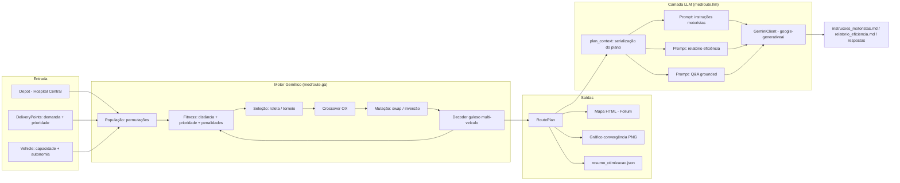
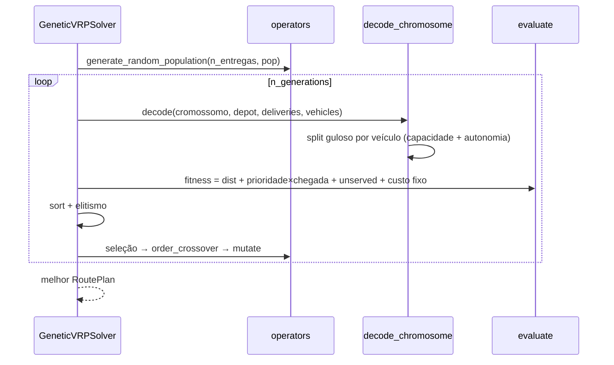

# Arquitetura — medroute (Projeto 2: Otimização de Rotas Médicas)

## Visão geral

## Camadas (arquitetura limpa)

| Camada | Módulo | Responsabilidade |
|---|---|---|
| Domínio | `medroute.domain` | Entidades (`DeliveryPoint`, `Vehicle`, `Depot`, `Route`, `RoutePlan`), `Priority` e restrições (`check_capacity`, `check_autonomy`, `route_distance`) |
| GA | `medroute.ga` | Cromossomo + decoder (`chromosome.py`), operadores (`operators.py`), fitness (`fitness.py`), loop evolutivo (`engine.py`) |
| Visualização | `medroute.visualization` | `MapRenderer` (Folium → HTML), `plot_fitness_history` (Matplotlib → PNG) |
| LLM | `medroute.llm` | `GeminiClient` (SDK oficial, retry com backoff), `prompts.py` (engenharia de prompt + serialização do plano), `RouteReportGenerator` |
| App | `medroute.cli` | Orquestração: otimizar → artefatos → (opcional) relatórios LLM |
| Dados | `medroute.data` | `build_sample_scenario`: 12 entregas, 3 veículos heterogêneos |

## Fluxo evolutivo (evoluído do `tsp.py` base)

## Decisões-chave

- **Cromossomo = permutação de índices de entrega** — preserva os operadores clássicos do código base (OX e mutação de permutação) sem alteração estrutural; a complexidade do VRP fica no **decoder**.
- **Decoder guloso com hard constraints** — varre o cromossomo e atribui cada entrega ao primeiro veículo onde a inserção não viola capacidade nem autonomia; sobras vão para `unserved` (penalizadas no fitness). Garante que toda solução avaliada é operacionalmente viável.
- **Prioridade como soft constraint** — `prioridade × distância de chegada` penaliza entregas críticas tardias sem inviabilizar soluções; `unserved × prioridade` torna medicamento crítico não entregue 10× pior que regular.
- **LLM desacoplada via protocolo `LLMClient`** — `RouteReportGenerator` não depende do Gemini; testes usam `FakeClient`; a chave fica só no `.env`.
